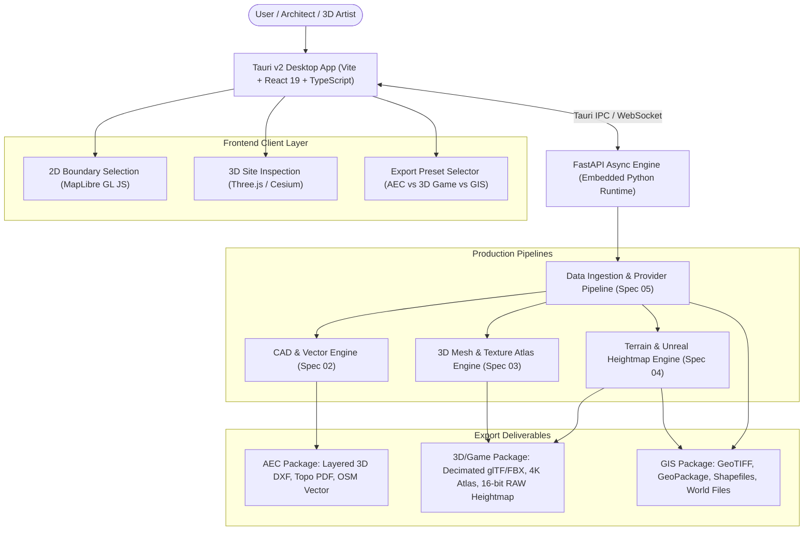

# Level Up Studio Aleph — Production Specification Index

**Version:** 3.0 (Production Architecture)  
**Status:** Approved Specification  
**Foundation:** Tauri v2 + React/TypeScript + FastAPI Python Core

---

## 1. System Vision

Level Up Studio Aleph is an enterprise-grade desktop platform that bridges the physical world and digital creative environments (AEC/CAD, 3D Visualization, Game Engines, and GIS). 

Users can select any site on Earth using a high-precision 2D/3D viewport, configure layer requirements and quality targets, and export standardized, production-ready deliverables without relying on external proprietary software (such as AutoCAD).

---

## 2. Specification Directory Structure

The system specifications are organized into distinct technical modules within `docs/spec/`:

| Spec File | Feature Area | Primary Responsibility |
|---|---|---|
| [**`01-architecture-desktop-shell.md`**](file:///c:/Users/MOZ/Desktop/Level-Up-Studio-Aleph/Level-Up-Studio-Aleph/docs/spec/01-architecture-desktop-shell.md) | **Desktop Shell & Process Supervisor** | Tauri v2 windowing, security boundaries, embedded Python runtime lifecycle, typed IPC protocol, and native installer generation. |
| [**`02-cad-engine-deliverables.md`**](file:///c:/Users/MOZ/Desktop/Level-Up-Studio-Aleph/Level-Up-Studio-Aleph/docs/spec/02-cad-engine-deliverables.md) | **Standalone CAD Generation** | Zero-AutoCAD DXF R2018 generation via `ezdxf`, 3D contour lines with true $Z$ elevation, building footprints, road networks, and optional ODA DWG conversion. |
| [**`03-3d-mesh-optimization-texture-baking.md`**](file:///c:/Users/MOZ/Desktop/Level-Up-Studio-Aleph/Level-Up-Studio-Aleph/docs/spec/03-3d-mesh-optimization-texture-baking.md) | **3D Photogrammetry & Mesh Optimization** | Google Earth / OGC 3D Tiles decoding, Quadric Error Metrics (QEM) polygon decimation, unified 4K PBR texture atlas repacking, and glTF/FBX export. |
| [**`04-terrain-topography-heightmaps.md`**](file:///c:/Users/MOZ/Desktop/Level-Up-Studio-Aleph/Level-Up-Studio-Aleph/docs/spec/04-terrain-topography-heightmaps.md) | **Terrain & Heightmap Engine** | Digital Elevation Model (DEM) slicing, contour interpolation, 16-bit/32-bit grayscale Unreal Engine heightmaps (`.png`/`.r16`), and slope/aspect heatmaps. |
| [**`05-data-providers-georeferencing.md`**](file:///c:/Users/MOZ/Desktop/Level-Up-Studio-Aleph/Level-Up-Studio-Aleph/docs/spec/05-data-providers-georeferencing.md) | **Data Ingestion & Georeferencing** | Hybrid dual-track providers (Open Data + BYOK official APIs + fallback scraper), and geodesic projection with Local Origin $(0,0,0)$ datum and world files. |
| [**`06-frontend-ui-viewport.md`**](file:///c:/Users/MOZ/Desktop/Level-Up-Studio-Aleph/Level-Up-Studio-Aleph/docs/spec/06-frontend-ui-viewport.md) | **Frontend UI & 3D Viewport** | Vite + React + TypeScript component tree, MapLibre GL 2D drawing, Three.js 3D inspection, sun/shadow simulator, and export preset workflows. |

---

## 3. Core Technical Standards

* **Coordinate Precision:** Dual-coordinate system (Local project datum at $(0, 0, 0)$ for CAD/DCC stability, plus EPSG/UTM coordinate sidecar for GIS alignment).
* **CAD Standards:** AutoCAD R2018 DXF specification, AIA/NCS-compliant layer naming (`SITE-*`, `BLDG-*`).
* **3D Standards:** Khronos Group glTF 2.0 Binary (`.glb`) with embedded PBR materials (`KHR_materials_unlit` / standard metallic-roughness), plus universal FBX/OBJ.
* **Terrain Standards:** 16-bit unsigned integer grayscale PNG and raw float32 TIFF.

