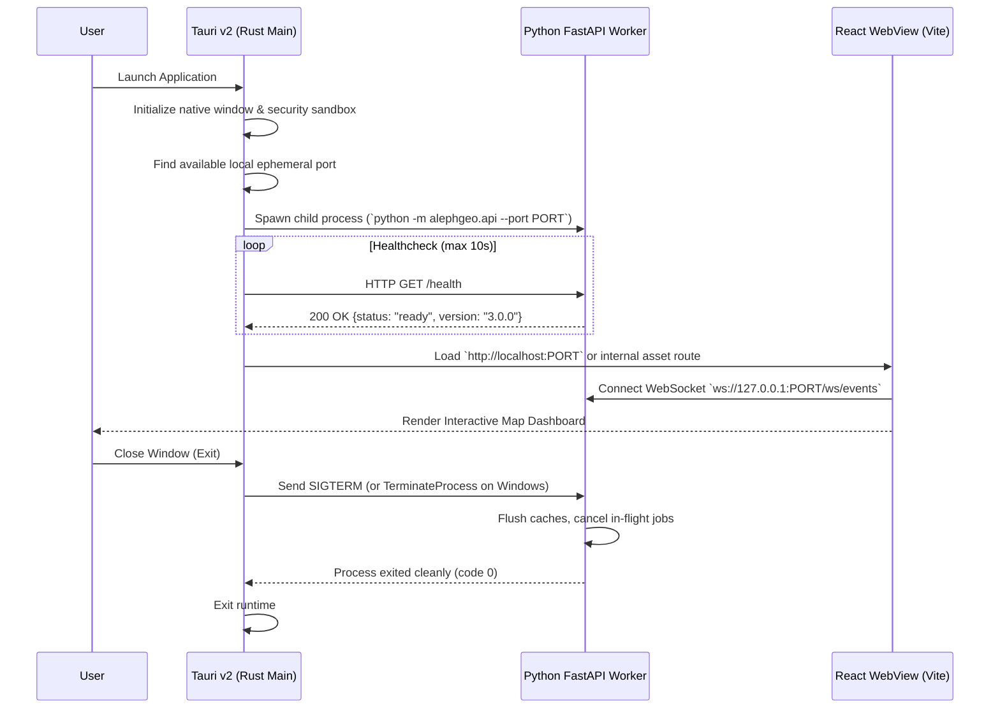

# Specification 01: Desktop Shell & Process Supervisor

**Module:** Architecture & Native Packaging  
**Components:** Tauri v2 (Rust Core) + React/TypeScript Frontend + Embedded FastAPI Python Engine

---

## 1. Overview & Objectives

The legacy architecture wrapped a hidden Python HTTP server using `pywebview` (Microsoft Edge WebView2) and packaged everything via PyInstaller into a monolithic 66 MB executable. This introduced socket collisions, fragile port handling, slow startup, and uncontrolled background process zombies if the app crashed.

This specification defines the production **Tauri v2** native desktop shell, providing:
1. **Instant Startup (~50ms native binary):** Fast window initialization using the operating system's native webview.
2. **Process Supervisor:** Robust child-process lifecycle management for the embedded Python FastAPI worker, guaranteeing clean start, health checks, and zero zombie processes upon exit.
3. **Typed IPC Bridge:** Memory-based Tauri commands for window controls and OS dialogs, with WebSocket streaming for live capture progress.
4. **Lean Installer:** Modular packaging producing an installer with a signed, verified payload.

---

## 2. Process Architecture & Lifecycle



---

## 3. Rust Supervisor Implementation Details

In `src-tauri/src/main.rs`, the Tauri supervisor manages the Python background service:

```rust
use tauri::{Manager, Emitter};
use std::process::{Command, Child};
use std::sync::Mutex;
use std::net::TcpListener;

struct BackendProcess(Mutex<Option<Child>>);

fn get_available_port() -> u16 {
    let listener = TcpListener::bind("127.0.0.1:0").expect("Failed to bind ephemeral port");
    listener.local_addr().unwrap().port()
}

#[tauri::command]
fn get_api_endpoint(state: tauri::State<ApiConfig>) -> String {
    format!("http://127.0.0.1:{}", state.port)
}

fn main() {
    let port = get_available_port();
    
    tauri::Builder::default()
        .manage(ApiConfig { port })
        .manage(BackendProcess(Mutex::new(None)))
        .setup(move |app| {
            let app_handle = app.handle().clone();
            
            // Resolve path to bundled Python binary
            let python_path = app.path().resolve("binaries/python/python.exe", tauri::path::BaseDirectory::Resource)?;
            
            let child = Command::new(python_path)
                .args(["-m", "alephgeo.api", "--port", &port.to_string()])
                .spawn()
                .expect("Failed to start embedded Aleph Python core");
                
            *app.state::<BackendProcess>().0.lock().unwrap() = Some(child);
            
            Ok(())
        })
        .on_window_event(|window, event| {
            if let tauri::WindowEvent::Destroyed = event {
                // Guaranteed cleanup on window close
                if let Some(mut child) = window.state::<BackendProcess>().0.lock().unwrap().take() {
                    let _ = child.kill();
                }
            }
        })
        .invoke_handler(tauri::generate_handler![get_api_endpoint])
        .run(tauri::generate_context!())
        .expect("Error while running Tauri application");
}
```

---

## 4. Native Dialogs & File System Access

Instead of relying on browser download hacks that can get blocked by WebView2 security policies:
* **Native Folder Picker:** Tauri native command `dialog::FileDialogBuilder` allows the user to choose custom capture destinations directly from the Windows Explorer or macOS Finder.
* **Direct File System Writes:** Completed deliverables are assembled directly into user-selected directories without passing multi-gigabyte ZIP streams across browser memory buffers.
* **Auto-Launch CAD / DCC Tools:** Optional one-click button in the UI:
  - *"Open in AutoCAD"* (launches `.dxf`/`.dwg` with default system association).
  - *"Open in Blender"* (launches `.glb` with default 3D app).
  - *"Show in File Explorer"*.

---

## 5. Build & Packaging Pipeline

* **Windows:** Tauri NSIS bundle generating a clean, modern installer with:
  - Custom install path selection.
  - Desktop & Start Menu shortcuts.
  - Proper uninstaller that cleans up temporary tile caches.
* **CI/CD Automation (GitHub Actions):**
  - Build pipeline compiles Rust binary, bundles the isolated Python virtual environment with dependencies pre-installed, runs automated tests, and creates versioned release artifacts (`Level-Up-Studio-Aleph-v3.0.0-Setup.exe`).

