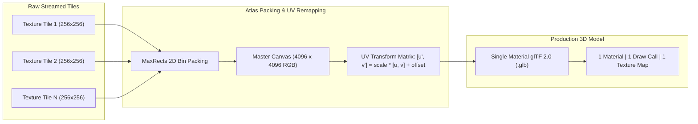

# Specification 03: 3D Mesh Optimization & Texture Atlas Baking

**Module:** 3D Photogrammetry & Geometry Engine  
**Core Technologies:** `trimesh`, `numpy`, `Pillow`, `gltf` (Khronos 2.0), MaxRects Bin Packing

---

## 1. Overview & Objectives

Google Earth photogrammetry streams 3D geometry in an octree hierarchy. While visually rich, raw streamed tiles exhibit severe technical bottlenecks when imported into DCC tools (Blender, 3ds Max, Maya) or real-time game engines (Unreal Engine 5, Unity):
1. **Severe Draw-Call Penalties:** A single captured city block creates hundreds of disconnected sub-meshes, each with its own $256 \times 256$ or $512 \times 512$ texture. In game engines, this results in hundreds of separate draw calls, crippling real-time frame rates.
2. **Dense, Unoptimized Topology:** Photogrammetry creates millions of redundant triangles in flat areas (roofs, roads, parking lots).
3. **Open Perimeter Skirts:** Raw meshes cut off abruptly at the selection boundary, leaving jagged, non-manifold edges that look unnatural in architectural presentations.

This specification defines the **Mesh Optimization & Texture Atlas Engine**, which produces production-ready, clean 3D assets with:
- **Quadric Error Metrics (QEM) Decimation:** Configurable target triangle counts with edge preservation.
- **Unified 4K Texture Atlas Repacking:** Merges hundreds of tiny texture patches into a single master PBR albedo map with recalculated UV coordinates.
- **Architectural Skirt Extrusion:** Fills perimeter boundaries down to a flat base plane, creating a solid "architectural maquette" block.
- **Format Delivery:** Standardized Khronos **glTF 2.0 Binary (`.glb`)**, **FBX**, and **OBJ + MTL**.

---

## 2. Texture Atlas Baking & UV Transformation



### UV Coordinate Transformation Formula

When a tile of dimensions $(w, h)$ is placed on a master atlas of size $(W, H)$ at pixel offset $(x_0, y_0)$:

$$\begin{aligned}
u' &= \frac{x_0 + u \cdot w}{W} \\
v' &= \frac{y_0 + v \cdot h}{H}
\end{aligned}$$

Where:
- $(u, v) \in [0, 1]$ are the original vertex texture coordinates within the sub-tile.
- $(u', v') \in [0, 1]$ are the remapped vertex coordinates referencing the master atlas.
- Bilinear edge padding (gutter of 2–4 pixels) prevents texture bleeding across mipmaps.

---

## 3. Quadric Error Metrics (QEM) Decimation

The mesh decimation pipeline reduces triangle count while preserving geometric silhouettes, building corners, and sharp elevation ridges:

| LOD Preset | Target Triangles | Typical File Size | Intended Target Workflow |
|---|---|---|---|
| **Original (LOD 0)** | 100% (Up to 1,500,000) | ~80–180 MB | High-end offline rendering (V-Ray, Corona, Cycles) |
| **High (LOD 1)** | 250,000 triangles | ~25–45 MB | Detailed architectural site context & animation |
| **Medium (LOD 2)** | 75,000 triangles | ~8–15 MB | Real-time Unreal Engine 5 / Unity / WebGL preview |
| **Massing (LOD 3)** | 25,000 triangles | ~2–4 MB | Background city massing & mobile VR / AR |

```python
import trimesh
import numpy as np

def optimize_mesh(raw_mesh: trimesh.Trimesh, target_faces: int = 100_000) -> trimesh.Trimesh:
    """
    Decimates mesh topology using Quadric Error Metrics, preserves UV mappings,
    and removes degenerate/isolated zero-area triangles.
    """
    if len(raw_mesh.faces) <= target_faces:
        return raw_mesh
        
    # Simplify geometry with boundary preservation
    simplified = raw_mesh.simplify_quadric_decimation(face_count=target_faces)
    
    # Clean non-manifold vertices and unreferenced vertices
    simplified.remove_unreferenced_vertices()
    simplified.remove_degenerate_faces()
    
    return simplified
```

---

## 4. Watertight Architectural Skirt Generation

To deliver an aesthetically complete site model suitable for architectural reviews and 3D printing:
1. Detect boundary edges of the mesh (edges belonging to only one triangle).
2. Trace connected boundary loops matching the user-selected boundary polygon.
3. Extrude boundary vertices downwards along the vertical $Z$-axis to $Z_{\text{base}} = Z_{\min} - \Delta h$ (where $\Delta h$ is typically 5 to 10 meters).
4. Create quad faces connecting boundary vertices to the base plane.
5. Create a flat bottom cap polygon.
6. Assign a clean neutral architectural plaster/concrete material to the skirts and base.

```
       [Photogrammetry Surface]
        /\      /\  /\    /\
       /  \    /  \/  \  /  \
      /    \  /        \/    \
     |                        |  <-- Vertical Skirt Walls
     |                        |      (Extruded to Base Elevation)
     +------------------------+  <-- Flat Solid Base
```

