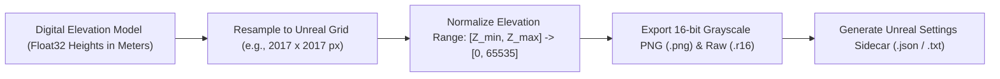

# Specification 04: Terrain, Topography & Unreal Heightmaps

**Module:** Terrain Surface & Elevation Analysis  
**Core Technologies:** `numpy`, `rasterio` / `tifffile`, `Pillow`, `scipy`

---

## 1. Overview & Objectives

Accurate ground topography is essential for both civil engineering (drainage, cut-and-fill grading, foundation design) and game development (Unreal Engine 5 Landscape streaming, Blender terrain modeling).

While the legacy app downloaded raw Terrarium elevation tiles and stitched an internal `.tif`, it did not provide:
1. **Unreal Engine 5-Ready Heightmaps:** Game engines require 16-bit or 32-bit single-channel grayscale rasters with specific power-of-two dimensions (e.g., $1009 \times 1009$, $2017 \times 2017$, $4033 \times 4033$) and precise scale multipliers.
2. **Topographic Slope Analysis:** Architects and civil engineers need slope gradients to identify buildable areas, hazard zones, and road gradient compliance.
3. **Terrain Profile Slicing:** Elevation cross-sections along arbitrary user-drawn paths.

This specification details the **Terrain Engine** that generates calibrated 16-bit heightmaps, slope heatmaps, and cross-section profiles.

---

## 2. 16-Bit Grayscale Heightmap for Unreal Engine & Blender

Game engines use 16-bit unsigned integers ($0 \text{ to } 65,535$) to represent terrain elevation with sub-centimeter vertical accuracy, preventing the "terracing" or "stair-stepping" artifacts caused by standard 8-bit images.



### Normalization & Scale Calibration

For a terrain region with minimum elevation $Z_{\min}$ and maximum elevation $Z_{\max}$:

$$\text{Pixel}_{16}(x, y) = \text{round}\left( 65535 \times \frac{Z(x, y) - Z_{\min}}{Z_{\max} - Z_{\min}} \right)$$

### Unreal Engine 5 Import Calibration Formula

Unreal Engine calculates landscape vertex elevation using:

$$Z_{\text{world}} = (\text{Pixel}_{16} - 32768) \times \frac{Z_{\text{scale}}}{100 \times 128}$$

To ensure $1\text{ unit} = 1\text{ cm}$ in Unreal Engine, the export engine automatically outputs `unreal_landscape_config.json`:

```json
{
  "grid_dimensions": [2017, 2017],
  "elevation_range_meters": {
    "min": 142.50,
    "max": 386.20,
    "delta": 243.70
  },
  "unreal_import_settings": {
    "scale_x": 100.0,
    "scale_y": 100.0,
    "scale_z": 74.3701,
    "location_z_offset": 26435.0
  }
}
```

The game artist simply imports the `.r16` or 16-bit `.png` into Unreal Landscape mode and pastes the calculated `scale_z` value to achieve 1:1 real-world elevation fidelity.

---

## 3. Civil Slope & Drainage Analysis

The engine computes the first derivative of the digital elevation model across the $X$ and $Y$ spatial axes using Sobel convolution filters:

$$\begin{aligned}
G_x &= \frac{\partial Z}{\partial x}, \quad G_y = \frac{\partial Z}{\partial y} \\
\text{Slope}(\%) &= 100 \times \sqrt{G_x^2 + G_y^2} \\
\text{Slope Angle}(\theta) &= \arctan\left(\sqrt{G_x^2 + G_y^2}\right) \times \frac{180}{\pi}
\end{aligned}$$

### Civil Engineering Slope Classification

The slope raster is categorized into standard municipal grading brackets:

| Slope Bracket | Angle ($\theta$) | Civil Classification | Color Key |
|---|---|---|---|
| **0% – 5%** | $0^\circ – 2.9^\circ$ | Flat / Ideal Build Zone | Green |
| **5% – 10%** | $2.9^\circ – 5.7^\circ$ | Moderate Slope (Standard Foundation) | Yellow-Green |
| **10% – 20%** | $5.7^\circ – 11.3^\circ$ | Steep (Requires Stepped Foundation / Grading) | Yellow |
| **20% – 30%** | $11.3^\circ – 16.7^\circ$ | Severe Slope (Erosion Risk / Retaining Walls) | Orange |
| **> 30%** | $> 16.7^\circ$ | Non-Buildable / Cliff | Red |

A colored **Slope Analysis Map (`slope-analysis.pdf` & GeoTIFF)** is generated alongside the raw elevation data for site feasibility reports.

---

## 4. Interactive Elevation Profile Slicer

When the user draws an elevation cut line $A \to B$ across the site in the frontend UI:
1. The backend samples the DEM along the line at 1-meter intervals using bicubic spline interpolation.
2. Returns a JSON array of $[(\text{distance}_i, \text{elevation}_i)]$.
3. Frontend renders an interactive cross-section graph showing maximum gradient, lowest point, highest point, and total elevation gain.

