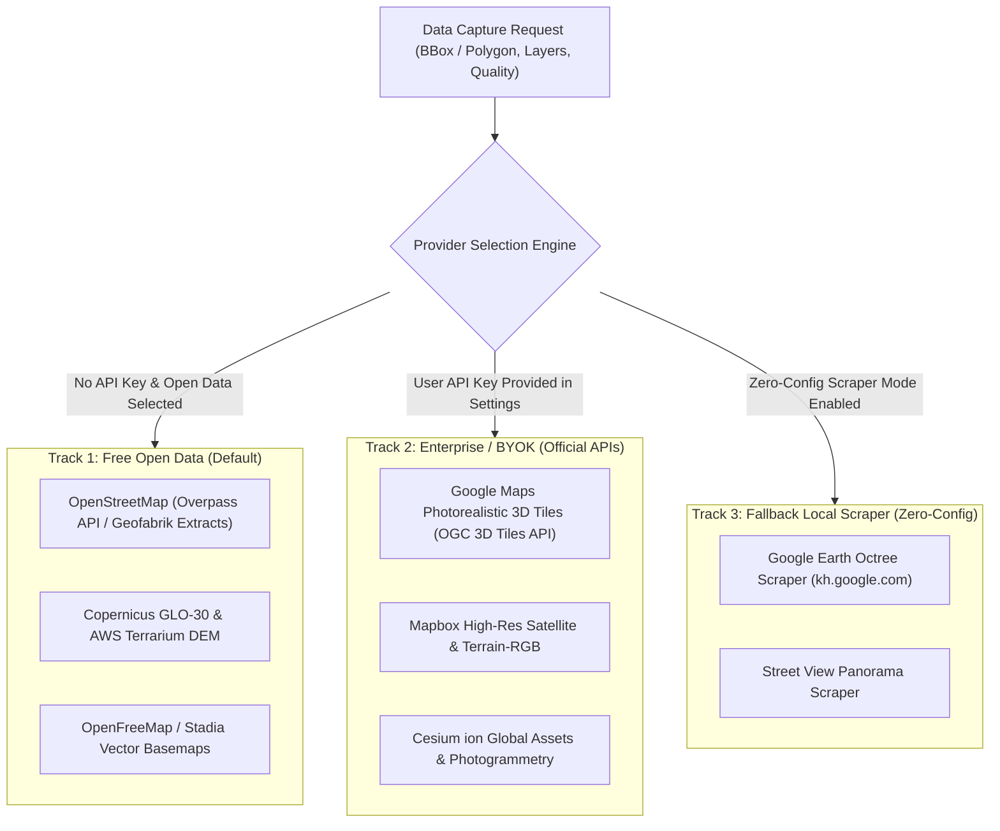

# Specification 05: Data Ingestion & Georeferencing Pipeline

**Module:** Provider Ingestion & Spatial Reference System  
**Core Technologies:** `pyproj`, `shapely`, OGC 3D Tiles, Overpass API, Copernicus DEM

---

## 1. Overview & Objectives

Production GIS and engineering applications require:
1. **Legal & Reliable Data Access:** Support for both open data and official licensed APIs (Bring Your Own Key - BYOK) alongside local fallback scrapers.
2. **Sub-Millimeter Georeferencing Precision:** Elimination of 32-bit floating-point jitter in CAD and 3D software while retaining exact real-world coordinate alignment for GIS tools.

This specification defines the **Hybrid Ingestion Architecture** and the **Georeferencing Engine**.

---

## 2. Hybrid Dual-Track Provider Architecture



### Provider Matrix

| Layer | Open Data Source | Enterprise / BYOK Source | Fallback Local Scraper |
|---|---|---|---|
| **Roads & Buildings** | OpenStreetMap (Overpass / PBF) | Mapbox Streets / Overture Maps | Cached Geofabrik extracts |
| **Terrain Elevation** | Copernicus GLO-30 (30m) & AWS Terrarium | Mapbox Terrain-RGB (0.1m precision) | AWS Terrain Tiles |
| **Satellite Imagery** | Sentinel-2 / Landsat (10m) | Google Maps High-Res Aerial (0.15m) | Google Satellite Tiles |
| **3D Photogrammetry** | OpenStreetMap 3D / OpenTopography | Google Photorealistic 3D Tiles API | Google Earth Octree Stream (`mesh.py`) |
| **Street Panoramas** | Mapillary / KartaView | Google Street View Publish API | Google Street View Tiles (`streetview.py`) |

---

## 3. Georeferencing & Floating-Point Jitter Solution

### The 32-Bit Floating-Point Precision Problem
In CAD tools (AutoCAD, Rhino) and game engines (Unreal Engine, Blender), coordinates are frequently processed using 32-bit single-precision floats (24 bits of significand):
* At Web Mercator coordinates ($Y \approx 6,000,000 \text{ m}$ in Europe/North America), precision drops to **~0.5 to 1.0 meter**.
* Vertices vibrate, lines fail to snap, and camera views shake erratically.

### The Solution: Local Project Datum $(0, 0, 0)$ + Georeference Sidecar

1. **Local Site Anchor:** The geometric center of the user's selected boundary is designated as the Local Site Origin $(0, 0, 0)$.
2. All exported vertices in DXF, OBJ, FBX, and glTF are calculated as offsets in meters from this origin:
   $$X_{\text{local}} = X_{\text{UTM}} - X_{\text{origin}}, \quad Y_{\text{local}} = Y_{\text{UTM}} - Y_{\text{origin}}, \quad Z_{\text{local}} = Z_{\text{AMSL}} - Z_{\text{origin}}$$
3. Precision is maintained at sub-millimeter resolution ($< 0.1 \text{ mm}$).

### Georeference Sidecar Files

Every export package includes standardized georeference sidecars:

#### `georeference.json`
```json
{
  "crs": {
    "projected_epsg": 32631,
    "projected_name": "WGS 84 / UTM zone 31N",
    "geographic_epsg": 4326,
    "geographic_name": "WGS 84"
  },
  "local_origin": {
    "local_x": 0.0,
    "local_y": 0.0,
    "local_z": 0.0,
    "utm_easting": 448250.45,
    "utm_northing": 5411890.12,
    "amsl_elevation": 182.40,
    "latitude_wgs84": 48.85837,
    "longitude_wgs84": 2.29448
  },
  "cartography": {
    "grid_convergence_angle_deg": -0.84,
    "grid_scale_factor": 0.999612
  }
}
```

#### `model.prj` (ESRI WKT Standard)
Standard projection definition file so QGIS, ArcGIS, and Civil 3D immediately recognize the spatial reference system upon drag-and-drop.

